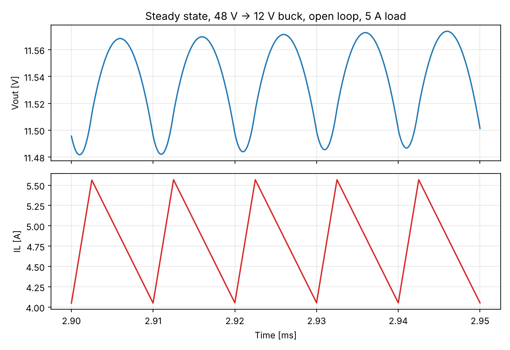
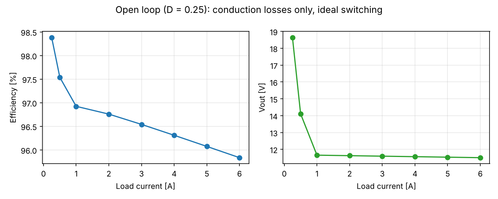

# 48 V → 12 V Buck Converter – Design & Simulation

Personal project (in progress) to apply the **Power Electronics** course from École Centrale de Lyon: sizing, simulating and controlling a DC-DC step-down converter.

## Specification

| Parameter | Value |
|---|---|
| Input voltage | 48 V |
| Output voltage | 12 V |
| Nominal output current | 5 A (60 W) |
| Switching frequency | 100 kHz |
| Inductor current ripple | 30 % of I_out (1.5 A) |
| Output voltage ripple | 1 % of V_out (120 mV pk-pk) |

## Roadmap

- [x] **Step 1 – Hand sizing** (CCM): duty cycle, L, C, component ratings → [`design_calc.py`](design_calc.py)
- [ ] **Step 2 – LTspice simulation**: waveforms, ripple, efficiency vs. load, conduction and switching losses (netlist ready: [`simulation/buck_open_loop.cir`](simulation/buck_open_loop.cir), results to be added)
- [ ] **Step 3 – Python model**: switching-level model written ([`simulation/buck_model.py`](simulation/buck_model.py)); averaged model and comparison with LTspice to do
- [ ] **Step 4 – Closed-loop control**: PI regulator, load-step response
- [ ] **Step 5 – Improvement**: synchronous rectification vs. Schottky diode, efficiency comparison
- [ ] Final 2-page report

## Step 1 – Sizing (ideal CCM)

| Quantity | Formula | Result |
|---|---|---|
| Duty cycle | D = V_out / V_in | 0.25 |
| Inductance | L = V_out (1 − D) / (f · ΔI_L) | 60 µH |
| Inductor peak current | I_out + ΔI_L / 2 | 5.75 A |
| Output capacitance | C = ΔI_L / (8 · f · ΔV) | ≈ 15.6 µF → 22 µF |
| CCM boundary | I_out,min = ΔI_L / 2 | 0.75 A |

**Component ratings (to be justified):** MOSFET ≥ 75–100 V, > 6 A, low R_DS(on); Schottky diode 100 V / 10 A.
First-order estimate (V_f = 0.5 V, R_DS(on) = 25 mΩ assumed): diode loss ≈ 1.9 W, MOSFET conduction loss ≈ 0.16 W. Switching losses and ESR effects are **not** included yet.

## Preliminary results (Python switching model, open loop, D = 0.25)

Conduction losses only, ideal switching, assumed parasitics (see `simulation/buck_open_loop.cir`).

| Quantity | Result at 5 A |
|---|---|
| Average output voltage | 11.54 V (not 12 V: voltage drops, no regulation yet) |
| Output voltage ripple | ≈ 107 mV peak-to-peak |
| Inductor current ripple | ≈ 1.53 A peak-to-peak (peak 5.58 A) |
| Efficiency (conduction losses only) | ≈ 96 % |




Observations:
- Below the CCM boundary (≈ 0.75 A) the converter enters discontinuous conduction and the open-loop output voltage rises sharply (18.6 V at 0.25 A): a regulator is required (step 4).
- The efficiency rising at light load is an artifact of the model, which has no switching or fixed losses yet. It is **not** a prediction for real hardware.

## Usage

```bash
python design_calc.py            # step 1: hand sizing
python simulation/buck_model.py # Python switching model (needs numpy, matplotlib)
```

## Tools
LTspice · Python · Matlab
